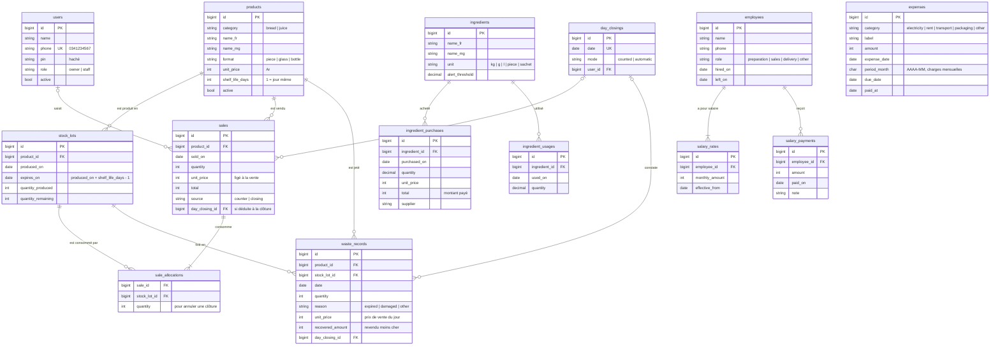

# Conception — gestion de la boulangerie

Ce document décrit le modèle de données, les règles de calcul et les décisions prises pour
l'API (`boulangerie-api`) et l'appli mobile (`boulangerie-app`). Monnaie : Ariary (MGA), montants
entiers sans décimales. Fuseau horaire : `Indian/Antananarivo`.

Les exemples chiffrés de ce document sont repris des tests automatisés
(`boulangerie-api/tests/Unit/*CalculatorTest.php`, `tests/Feature/DayClosingTest.php`) : ils sont
vérifiés à chaque `php artisan test`.

---

## 1. Décisions métier

Les points ambigus de la spécification ont été tranchés ainsi :

| Sujet | Décision |
|---|---|
| Connexion | Numéro de téléphone + code PIN de 4 à 6 chiffres. 5 essais par minute et par numéro. |
| Chiffres incohérents | Refusés avec un message clair : vente au-delà du stock, restant compté supérieur au disponible, utilisation d'ingrédient au-delà du stock. |
| Erreur dans une clôture validée | L'owner annule la **dernière** clôture (ventes et invendus effacés, quantités remises dans les lots), puis on recompte. Impossible si des ventes ou invendus existent déjà à une date plus récente. |
| « Mois non payés » | Solde dû ÷ salaire mensuel actuel, à une décimale (ex. 2,5 mois). |
| Ingrédients côté staff | Voir le stock, saisir les achats et les utilisations. La liste des ingrédients et la suppression de mouvements sont réservées à l'owner. |
| Recettes du jour | Visibles par le staff (ils encaissent). Factures et salaires dus : owner uniquement. |
| Comptes | L'owner crée les comptes, réinitialise un PIN et désactive un compte depuis l'appli. Un nouveau PIN ou une désactivation ferme les sessions ouvertes. |
| Commande `stock:close-day` | Lancée à la main uniquement (rattrapage d'une journée oubliée), pas planifiée. |

Choix par défaut, annoncés avant le développement :

- Semaine du lundi au dimanche ; mois calendaire.
- Une dépense dont `period_month` est rempli est une charge mensuelle répartie au prorata des jours.
  Sinon, elle compte à sa date `expense_date`. `period_month` est obligatoire pour l'électricité et le loyer.
- Dates incluses : `hired_on`, `left_on`, premier et dernier jour d'une période, « aujourd'hui » dans le solde dû.
- Salaires : montants exacts additionnés, arrondis une seule fois à l'ariary. Un mois complet donne donc
  exactement le salaire mensuel.
- Clôtures dans l'ordre chronologique. Une journée clôturée est figée : plus de production, vente ni
  invendu à cette date ou avant.
- Vente au comptoir et clôture le même jour : possible. La clôture n'enregistre que la différence.
- Malgache par défaut dans l'appli.

---

## 2. Modèle de données (MCD)

En plus de la spécification :

- `sale_allocations` mémorise quels lots chaque vente a consommés. C'est ce qui permet d'annuler
  une clôture en remettant chaque quantité dans son lot d'origine.
- `day_closings` trace chaque clôture : date unique, mode `counted` (écran) ou `automatic` (commande).
- `waste_records.unit_price` fige le prix de vente du jour, pour la valeur informative des invendus.
- `users.phone` / `users.pin` remplacent l'e-mail et le mot de passe.

---

## 3. Règles de calcul

### 3.1 Lots, stock et FIFO

- Une production crée un lot : `expires_on = produced_on + shelf_life_days - 1`. Un pain à 1 jour
  expire le jour même ; à 3 jours, le surlendemain.
- **Disponible** d'un produit à la date D = somme des `quantity_remaining` des lots tels que
  `produced_on ≤ D ≤ expires_on`.
- Ventes et invendus manuels consomment les lots dans l'ordre FIFO : le lot qui expire le premier,
  puis le plus ancien.

### 3.2 Clôture de journée (date D)

1. Pour chaque produit disponible, on saisit le **restant** compté le soir. Tous les produits en
   stock doivent être comptés, et le restant ne peut pas dépasser le disponible.
2. `vendu = disponible − restant`, enregistré comme vente (`source = closing`) au prix du jour, en FIFO.
3. Les lots arrivés à expiration (`expires_on ≤ D`) qui ont encore un reste passent en invendus
   (`reason = expired`). Cela inclut les lots d'une journée oubliée.
4. Les autres lots sont reportés au lendemain.
5. Un `recovered_amount` saisi pour un produit est porté sur son invendu. Il peut aussi être
   renseigné plus tard (`PATCH /waste-records/{id}`).

Les ventes au comptoir du jour ont déjà retiré leurs quantités des lots : la clôture ne compte que
ce qui reste.

**Exemple vérifié** (`DayClosingTest`), le 22 octobre :

| Produit | Lots | Disponible (dont expire ce soir) | Restant compté | Vendu | Invendus | Reporté |
|---|---|---|---|---|---|---|
| Baguette (1 jour, 800 Ar) | 50 produites le 22, dont 5 vendues au comptoir | 45 (45) | 8 | 37 → 29 600 Ar | 8 | 0 |
| Pain de mie (3 jours, 3 000 Ar) | A : 10 restants du 20 (expire le 22) ; B : 20 du 22 | 30 (10) | 12 | 18 → 54 000 Ar | 0 | 12 (lot B) |

En FIFO, les 18 pains de mie vendus vident d'abord le lot A (10), puis 8 du lot B.

Aperçu dans l'appli avant validation : `invendus = max(0, expirant − vendu) + restes déjà expirés`.

### 3.3 Ingrédients

- Stock = Σ achats − Σ utilisations. L'alerte s'affiche quand le stock est sous `alert_threshold`.
- Un achat se saisit avec le prix unitaire **ou** le total payé ; l'autre est calculé. C'est le
  `total` qui compte dans les charges, à la date d'achat.

### 3.4 Salaires (`SalaryCalculator`)

- Salaire en vigueur le jour d : le dernier `salary_rates` avec `effective_from ≤ d`.
- **Coût d'un jour** = salaire mensuel en vigueur / nombre de jours du mois, uniquement entre
  `hired_on` et `left_on` inclus.
- **Acquis sur une période** = somme des coûts journaliers, arrondie une fois à l'ariary.
- **Solde dû** = acquis depuis l'embauche jusqu'à aujourd'hui − paiements à cette date.
  Un solde négatif est une avance.
- **Mois non payés** = solde dû / salaire mensuel actuel, à une décimale.

Exemples vérifiés :

| Cas | Calcul | Résultat |
|---|---|---|
| Mois complet, 150 000 Ar | 31 × 150 000 / 31 | 150 000 |
| Changement en milieu de mois : 155 000 jusqu'au 15/10, 186 000 dès le 16/10 | 15 × 5 000 + 16 × 6 000 | 171 000 |
| Embauche le 10/10 à 155 000 | 22 jours × 5 000 | 110 000 |
| Départ le 20/10 | 20 jours × 5 000 | 100 000 |
| Semaine du 28/09 au 04/10 à 186 000 | 3 × 6 200 (sept., 30 j) + 4 × 6 000 (oct., 31 j) | 42 600 |
| Mois non payés : embauche 01/08 à 155 000, rien payé, au 15/10 | (155 000 + 155 000 + 75 000) / 155 000 = 2,48 | 2,5 mois |
| Avance : 10 jours acquis (50 000), 100 000 versés | 50 000 − 100 000 | −50 000 |

### 3.5 Bénéfice (`ProfitCalculator`) — comptabilité d'engagement

Pour une semaine (lundi → dimanche) ou un mois :

- **Recettes** = ventes de la période + `recovered_amount` des invendus de la période.
- **Charges** =
  - achats d'ingrédients dont `purchased_on` est dans la période ;
  - dépenses ponctuelles (`period_month` vide) dont `expense_date` est dans la période ;
  - charges mensuelles : `montant × jours de la période dans period_month / jours du mois` ;
  - salaires acquis sur la période, qu'ils soient payés ou non.
- **Bénéfice** = Recettes − Charges.

Pour une période en cours, salaires et charges mensuelles ne sont comptés que jusqu'à aujourd'hui,
pour être comparés aux recettes à date (`partial: true` dans la réponse).

Indicateurs en plus :

- recettes par catégorie (pain / jus) ;
- top 5 des produits par chiffre d'affaires ;
- invendus : quantité et valeur au prix de vente. Cette valeur est la perte de chiffre d'affaires,
  **informative** : elle n'est pas déduite. Le coût de ces invendus est déjà dans les ingrédients.
- série jour par jour (recettes, charges) pour le graphique.

---

## 4. Exemples chiffrés du bénéfice

### 4.1 Le mois d'octobre 2026 (mois terminé)

| Recettes | Montant |
|---|---|
| 1 000 baguettes × 500 Ar | 500 000 |
| 200 verres de jus × 1 000 Ar | 200 000 |
| Invendus revendus moins cher | 20 000 |
| **Total recettes** (pain 520 000, jus 200 000) | **720 000** |

| Charges | Calcul | Montant |
|---|---|---|
| Ingrédients achetés en octobre | | 150 000 |
| Transport (dépense ponctuelle) | | 30 000 |
| Électricité d'octobre (payée en novembre) | 31/31 × 62 000 | 62 000 |
| Loyer d'octobre | 31/31 × 93 000 | 93 000 |
| Salaire de l'employé 1 | mois complet à 155 000 | 155 000 |
| Salaire de l'employé 2, embauché le 22/10 | 10 jours × 5 000 | 50 000 |
| **Total charges** | | **540 000** |

**Bénéfice d'octobre = 720 000 − 540 000 = 180 000 Ar.**

La facture d'électricité payée en novembre compte bien en octobre, le mois qu'elle couvre.

### 4.2 Une semaine à cheval sur deux mois (28 septembre → 4 octobre)

| Charge | Calcul | Montant |
|---|---|---|
| Électricité de septembre, 60 000 | 3 jours × 60 000 / 30 | 6 000 |
| Électricité d'octobre, 62 000 | 4 jours × 62 000 / 31 | 8 000 |
| Salaire de 186 000 | 3 × 186 000 / 30 + 4 × 186 000 / 31 | 42 600 |
| **Total** | | **56 600** |

Chaque jour est valorisé avec la longueur de **son** mois.

### 4.3 Paiement groupé de plusieurs mois

Un employé embauché le 1er juillet à 120 000 Ar n'est payé que le 5 octobre : 360 000 Ar pour
juillet, août et septembre.

| Période | Salaire compté dans les charges |
|---|---|
| Juillet | 120 000 (acquis, même s'il n'est pas encore payé) |
| Août | 120 000 |
| Septembre | 120 000 |
| Octobre | 120 000, **et non** 120 000 + 360 000 |

Le paiement ne fausse pas le mois où il est fait. Il fait seulement baisser le solde dû : 360 000 Ar
(3 mois) au 30 septembre, puis 19 355 Ar au 5 octobre (5 jours d'octobre : 5 × 120 000 / 31).

### 4.4 Le mois en cours

Le 22 octobre, avec un salaire de 155 000 Ar et une électricité d'octobre de 62 000 Ar, le rapport
du mois compte 22 × 5 000 = 110 000 Ar de salaires et 22 × 2 000 = 44 000 Ar d'électricité, à
comparer aux recettes du 1er au 22 octobre.

---

## 5. Sécurité et rôles

| Ressource | owner | staff |
|---|---|---|
| Production, ventes, clôture, invendus, stock | ✔ | ✔ |
| Annuler une clôture | ✔ | ✘ |
| Catalogue produits (prix) | lecture + écriture | lecture |
| Ingrédients : stock, achats, utilisations | ✔ | ✔ |
| Ingrédients : liste, suppression de mouvements | ✔ | ✘ |
| Employés, salaires, paiements | ✔ | ✘ |
| Dépenses, factures | ✔ | ✘ |
| Rapports (bénéfice) | ✔ | ✘ |
| Comptes de connexion | ✔ | ✘ |
| Tableau de bord : factures et salaires dus | ✔ | ✘ (absents de la réponse) |

Côté API, les droits sont appliqués par des policies Laravel ; côté appli, le routeur masque aussi
les écrans owner.

---

## 6. Limites connues

- Les textes malgaches (appli et messages de l'API) sont à faire relire par un locuteur natif.
- Les boutons système du calendrier s'affichent en français quand l'appli est en malgache
  (repli expliqué dans `boulangerie-app/README.md`).
- Le jeton de session est gardé dans les préférences de l'appli (`shared_preferences`).
  Pour un téléphone partagé, `flutter_secure_storage` serait plus sûr.
- Pas de mode hors ligne : sans réseau, l'appli affiche l'erreur et un bouton « Réessayer ».
